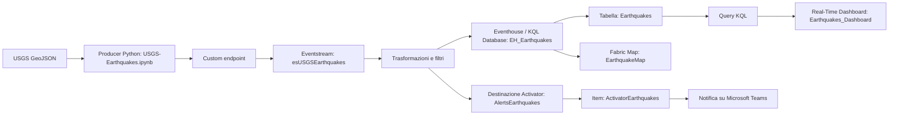

# Real-Time Intelligence — USGS Earthquakes

## 1. Autori

- Fabio Petruzzi

## 2. Obiettivo

Realizzare una pipeline di analisi degli eventi sismici con Microsoft Fabric:

- acquisizione dei dati dalla fonte USGS;
- produzione e invio di eventi JSON tramite Python;
- ingestione e trasformazione in Eventstream;
- archiviazione in Eventhouse;
- analisi tramite query KQL;
- visualizzazione mediante dashboard e mappa;
- invio di notifiche tramite Activator.

## 3. Fonte dati e struttura dell’evento

Fonte: USGS Earthquakes, feed GeoJSON.

### Endpoint utilizzati

| Modalità | Endpoint |
| --- | --- |
| Monitoraggio e test giornaliero | https://earthquake.usgs.gov/earthquakes/feed/v1.0/summary/all_day.geojson |
| Caricamento iniziale settimanale | https://earthquake.usgs.gov/earthquakes/feed/v1.0/summary/all_week.geojson |

Il feed giornaliero permette di acquisire gli eventi presenti nella finestra giornaliera; quello settimanale viene utilizzato per popolare inizialmente le analisi.

L’invio di un evento storico non equivale al verificarsi di un nuovo terremoto: si tratta dell’acquisizione o del reinvio di dati reali già pubblicati dalla fonte.

### Struttura dell’evento

Ogni feature GeoJSON viene trasformata in un evento JSON piatto.

| Campo | Tipo nel payload | Significato |
| --- | --- | --- |
| `event_id` | string | Identificativo USGS |
| `event_time` | string ISO 8601 UTC | Istante del sisma |
| `updated_time` | string ISO 8601 UTC | Ultima revisione della fonte |
| `magnitude` | number o null | Magnitudo |
| `mag_type` | string o null | Tipo di magnitudo |
| `place` | string o null | Descrizione geografica |
| `latitude` | number | Latitudine |
| `longitude` | number | Longitudine |
| `depth_km` | number | Profondità in chilometri |
| `area` | string | Raggruppamento geografico del producer |
| `event_type` | string | Tipo di evento |
| `status` | string | Stato della revisione |
| `network` | string | Rete di rilevamento |
| `significance` | integer | Indicatore USGS di significatività |
| `tsunami` | integer | Indicatore USGS, non un allarme autonomo del progetto |
| `ingest_time` | string ISO 8601 UTC | Istante di costruzione del payload nel producer |

Il campo `area` viene calcolato mediante fasce di longitudine:

| Area | Condizione |
| --- | --- |
| `americas` | `-170 ≤ longitude < -30` |
| `europe_africa` | `-30 ≤ longitude < 60` |
| `asia_pacific` | Tutti gli altri casi |

Questa suddivisione è una classificazione semplificata, non un’identificazione geografica puntuale.

### Esempio di evento

Il seguente JSON illustra la struttura del payload e non rappresenta la prova di un sisma reale.

```json
{
  "event_id": "example_event",
  "event_time": "2026-10-30T12:00:00+00:00",
  "updated_time": "2026-10-30T12:05:00+00:00",
  "magnitude": 4.5,
  "mag_type": "mb",
  "place": "Località di esempio",
  "latitude": 42.0,
  "longitude": 13.0,
  "depth_km": 10.0,
  "area": "europe_africa",
  "event_type": "earthquake",
  "status": "reviewed",
  "network": "example",
  "significance": 300,
  "tsunami": 0,
  "ingest_time": "2026-10-30T12:06:00+00:00"
}
```

Gli esempi acquisiti dalla fonte sono disponibili in `producer/sample_events.json`.

## 4. Architettura

Workspace: `Esercitazione Real-Time`.

Database KQL: `EH_Earthquakes`.

### Schema logico



Il diagramma rappresenta il flusso logico del progetto.

La topologia effettiva dell’Eventstream, inclusi i rami verso le destinazioni, è documentata in `eventstream/topologia.png`.

## 5. Esecuzione del producer

### Prerequisiti

- Python; versione registrata nel notebook: `3.11.9`.
- Un ambiente capace di eseguire notebook Jupyter, ad esempio VS Code con supporto notebook oppure Jupyter.
- Accesso alla fonte USGS.
- Accesso al Custom endpoint configurato in Microsoft Fabric.
- Eventstream pubblicato e destinazioni configurate.

Il producer viene consegnato come notebook:

```text
producer/USGS-Earthquakes.ipynb
```

### Installazione delle dipendenze

Dalla cartella principale del progetto:

```bash
cd producer
python -m pip install -r requirements.txt
```

Dipendenze dirette e versioni registrate negli output del notebook:

```text
azure-eventhub==5.15.1
requests==2.34.2
python-dotenv==1.2.4
```

### Configurazione delle credenziali

Creare localmente un file `.env` nella cartella del notebook, utilizzando come modello `.env.example`.

Configurare la variabile:

```dotenv
FABRIC_CUSTOM_ENDPOINT_CONNECTION_STRING=
```

Il valore deve essere la connection string del Custom endpoint.

Il file `.env` reale non deve essere pubblicato. Nel repository è presente soltanto `.env.example`, senza credenziali.

### Avvio del notebook

Aprire `USGS-Earthquakes.ipynb` in VS Code o Jupyter e selezionare l’ambiente Python nel quale sono state installate le dipendenze.

Se Jupyter Notebook è già installato, dalla cartella `producer/` è possibile avviarlo con:

```bash
jupyter notebook USGS-Earthquakes.ipynb
```

Eseguire quindi le celle secondo l’ordine e la modalità operativa descritti di seguito.

### Parametri

| Parametro | Valore nel notebook | Uso |
| --- | --- | --- |
| `FEED_URL` | `all_day.geojson` | Feed iniziale; alcune celle lo modificano |
| `DURATA_SEC` | `600` | Finestra del ciclo di monitoraggio, in secondi |
| `PAUSA` | `60` | Pausa tra i cicli, in secondi |
| `MAX_EVENTI_SEC` | `10` | Ritmo medio obiettivo dell’invio |
| `MAX_RETRY` | `5` | Numero massimo di tentativi per operazione |
| `BATCH_SIZE` | `20` | Numero di eventi per blocco applicativo |

Il producer invia blocchi e poi attende:

```python
time.sleep(len(blocco) / MAX_EVENTI_SEC)
```

Il valore di 10 eventi al secondo è un obiettivo medio, non un limite rigido su ogni singolo secondo. Chiamate di rete, retry e pause possono prolungare la durata effettiva.

### Ordine delle celle e modalità operative

Non utilizzare indiscriminatamente `Run All`: il notebook contiene tre modalità operative che possono reinviare gli stessi dati.

#### Preparazione comune

1. Installare le dipendenze tramite `requirements.txt` oppure con la prima cella del notebook.
2. Eseguire la cella degli import, della connessione e dei parametri.
3. Eseguire la cella che definisce `iso_utc`, `get_terremoti`, `area_di` e `to_dict`.
4. Eseguire la cella che genera `sample_events.json`, dopo la definizione delle funzioni.
5. Eseguire la cella che crea `producer` e definisce `invia_batch`.

#### A. Monitoraggio continuo

- Impostare `FEED_URL` al feed giornaliero, soprattutto se in precedenza è stato utilizzato quello settimanale.
- Eseguire la cella che inizia con:

  ```python
  visti, totale, fine, ciclo = ...
  ```

- Il primo giro acquisisce gli eventi del feed.
- I giri successivi selezionano le versioni non ancora viste nella stessa esecuzione utilizzando la coppia `(event_id, updated_time)`.
- Al termine, oppure dopo un’interruzione, il producer viene chiuso.
- Per ripetere il monitoraggio, ricreare il producer prima di rieseguire il ciclo.

#### B. Caricamento iniziale settimanale

- Eseguire la cella denominata “Caricamento iniziale: eventi dell’ultima settimana”.
- Eseguire la successiva cella di invio di `eventi_settimana`, che ricrea e chiude il producer.
- Gli eventi con magnitudo nulla vengono esclusi dalla lista.

#### C. Test giornaliero

- Eseguire la cella denominata “Test completo con dati USGS reali dell’ultimo giorno”.
- La cella rilegge il feed, filtra le magnitudo nulle, deduplica la lista e mostra quanti eventi hanno `magnitude > 5`.
- Eseguire la cella finale di invio di `eventi_test`, che ricrea e chiude il producer.
- Rieseguire soltanto la cella finale reinvia la lista già presente in memoria: non aggiorna i dati dalla fonte.

## 6. Trasformazioni, storage e analisi

### Eventstream

Il dettaglio delle trasformazioni pubblicate è documentato in `eventstream/README.md`, con una tabella organizzata nelle colonne:

```text
Nodo | Tipo | Configurazione
```

Il progetto prevede il filtro degli eventi con magnitudo non nulla. La topologia e gli altri operatori sono documentati negli allegati dell’Eventstream.

File di riferimento:

- `eventstream/README.md`
- `eventstream/topologia.png`
- `eventstream/preview.png`

### Eventhouse

Lo schema e i tipi effettivi della tabella KQL sono documentati in:

```text
eventhouse/schema.kql
```

I timestamp sono stringhe ISO 8601 nel payload e vengono gestiti con tipi coerenti nello storage e nelle query.

Statistiche ed esempi di dati:

- `eventhouse/stats.md`
- `eventhouse/sample_data.csv`

### Analisi KQL

Le domande di audit, le query e i relativi risultati si trovano in:

- `queries/queryset.kql`
- `queries/results/`

### Distinzione temporale

| Campo | Significato |
| --- | --- |
| `event_time` | Quando è avvenuto il sisma |
| `updated_time` | Quando la fonte ha revisionato l’evento |
| `ingest_time` | Quando il producer ha costruito il payload |

Il campo `ingest_time` non viene ricalcolato quando si reinvia una lista di eventi già preparata.

## 7. Dashboard e Activator

### Real-Time Dashboard

Nome della dashboard:

```text
Earthquakes_Dashboard
```

La dashboard presenta le analisi del progetto e le visualizzazioni degli eventi sismici.

File di riferimento:

- `dashboard/dashboard.json`
- `dashboard/full.png`
- `dashboard/filtered_Americhe.png`
- `dashboard/filtered_Asia_Pacifico.png`
- `dashboard/filtered_Europa_Africa.png`
- `dashboard/tiles.md`

### Activator

| Elemento | Configurazione |
| --- | --- |
| Item | `ActivatorEarthquakes` |
| Destinazione Eventstream | `AlertsEarthquakes` |
| Regola | `USGS_Evento_Maggiore5` |
| Condizione | `magnitude > 5` |
| Azione | Messaggio su Microsoft Teams |

La definizione della regola e le notifiche ricevute sono documentate nella cartella `activator/`.

## 8. Estensione: Fabric Map

Nome della mappa:

```text
EarthquakeMap
```

La mappa utilizza la sorgente `EH_Earthquakes` e le funzioni:

- `EarthquakesMap`
- `EarthquakesMapTest`

Sono presenti un layer principale dedicato agli epicentri e un layer di test per le ricezioni recenti.

| Layer | Descrizione |
| --- | --- |
| Principale | Epicentri con magnitudo > 4; riferimento temporale settimanale |
| Test | Layer denominato “Test – Ricezioni ultimi 2 minuti”, utilizzato nelle prove di ricezione |

La finestra effettiva del layer di test dipende dal filtro salvato nella funzione `EarthquakesMapTest`. Il nome del layer e l’intervallo selezionato nell’interfaccia vanno interpretati insieme alla query.

Una finestra di ricezione breve può restituire zero righe quando il producer non sta inviando: questo non dimostra, da solo, un guasto della pipeline.

File di riferimento:

- `dashboard/Mappa.png`
- `dashboard/MappaAllDay.png`

## 9. Prove registrate e limiti

### Risultati delle esecuzioni salvate

| Prova | Risultato |
| --- | --- |
| Monitoraggio, primo ciclo | 205 eventi |
| Monitoraggio, secondo ciclo | 1 evento aggiuntivo |
| Monitoraggio, terzo ciclo | 0 eventi aggiuntivi |
| Caricamento iniziale settimanale | 1.845 eventi inviati su 1.845 |
| Lista di test giornaliera | 199 eventi |
| Eventi della lista con magnitudo > 5 | 12 |
| Invio della lista di test | 199 eventi inviati su 199 |

Inizio del test riportato nell’output:

```text
2026-10-30T16:50:51.772923+00:00
```

Questi valori descrivono le esecuzioni registrate nel notebook e non costituiscono conteggi correnti del feed né una verifica del numero di righe archiviate nel database.

### Limiti della versione consegnata

- La deduplicazione del monitoraggio è in memoria e si azzera a ogni riavvio della relativa cella.
- Nel ciclo continuo le chiavi vengono marcate come viste prima della conferma di invio. Se tutti i retry falliscono, gli eventi possono non essere riprovati nei cicli successivi della stessa esecuzione.
- Un retry dopo un invio parziale può produrre duplicati: la gestione delle versioni nelle query resta necessaria.
- Dopo l’esaurimento dei retry sul feed, `get_terremoti()` restituisce una lista vuota. Occorre controllare i log per distinguere l’assenza di novità dagli errori di lettura.
- I caricamenti e i test sono replay di dati reali, non una simulazione di terremoti nuovi.

## 10. Stato dei requisiti e allegati

Lo stato riportato di seguito riflette la documentazione di consegna del progetto.

| Requisito | Stato | File e documentazione |
| --- | --- | --- |
| Producer JSON, timestamp UTC, parametri, batch e retry | Fatto | `producer/USGS-Earthquakes.ipynb`; limiti descritti nella sezione 9 |
| Dipendenze e istruzioni di avvio | Fatto | `producer/requirements.txt` e sezione 5 del README |
| Segreti esterni al codice | Fatto | Variabile d’ambiente e `producer/.env.example`; `.env` escluso dal repository |
| Cinque eventi JSON di esempio | Fatto | `producer/sample_events.json` |
| Eventstream pubblicato e almeno due trasformazioni | Fatto | `eventstream/topologia.png`, `eventstream/README.md`, `eventstream/preview.png` |
| Schema, statistiche e almeno 500 righe esportate | Fatto | `eventhouse/schema.kql`, `eventhouse/stats.md`, `eventhouse/sample_data.csv` |
| Almeno due query di audit e operatori richiesti | Fatto | `queries/queryset.kql` e `queries/results/` |
| Dashboard, mappa, parametri e auto-refresh | Fatto | `dashboard/dashboard.json`, `dashboard/full.png`, screenshot dei filtri e `dashboard/tiles.md` |
| Regola Activator avviata e testata | Fatto | `activator/rule.png`, `activator/alert.png`, `activator/README.md` |
| Estensione Fabric Map | Fatto | `dashboard/Mappa.png` e `dashboard/MappaAllDay.png` |

## 11. Problemi riscontrati e soluzioni

| Problema | Soluzione o stato |
| --- | --- |
| Invio limitato a 199 eventi | La cella scorre una sola volta `eventi_test`: la quantità dipende dalla lista preparata, non da un limite di Event Hubs. |
| Reinvio di una lista precedente | Rieseguire la preparazione del test prima dell’invio per rileggere i dati aggiornati dalla fonte. |
| Producer già chiuso | Ricreare `EventHubProducerClient` prima di un nuovo monitoraggio. Le celle di caricamento e test lo ricreano già. |
| Layer delle ricezioni recenti vuoto | Verificare nuove ingestioni e finestra temporale. Un replay può aggiornare le ricezioni senza cambiare i terremoti distinti. |
| Mancata ricezione di ulteriori alert | Problema riscontrato durante i test. I limiti di invio sono una possibile causa, da confermare tramite la diagnostica della regola e dell’azione. |


## 12. Organizzazione della consegna

I percorsi riportati di seguito sono relativi alla cartella principale del repository.

```text
fabric-usgs-earthquakes/
├── README.md
├── .gitignore
├── demo.mp4
│
├── activator/
│   ├── README.md
│   ├── alert.png
│   ├── alert2.png
│   ├── rule.png
│   └── rule2.png
│
├── dashboard/
│   ├── dashboard.json
│   ├── filtered_Americhe.png
│   ├── filtered_Asia_Pacifico.png
│   ├── filtered_Europa_Africa.png
│   ├── full.png
│   ├── Mappa.png
│   ├── MappaAllDay.png
│   └── tiles.md
│
├── eventhouse/
│   ├── sample_data.csv
│   ├── schema.kql
│   └── stats.md
│
├── eventstream/
│   ├── README.md
│   ├── preview.png
│   └── topologia.png
│
├── producer/
│   ├── .env.example
│   ├── requirements.txt
│   ├── sample_events.json
│   └── USGS-Earthquakes.ipynb
│
└── queries/
    ├── queryset.kql
    └── results/
        ├── queriesresultsQ1.csv
        ├── queriesresultsQ2.png
        ├── queriesresultsQ3.csv
        └── queryresultsQ4.png
```

Il file `.env` reale viene mantenuto soltanto nell’ambiente locale ed è escluso dal repository tramite `.gitignore`.